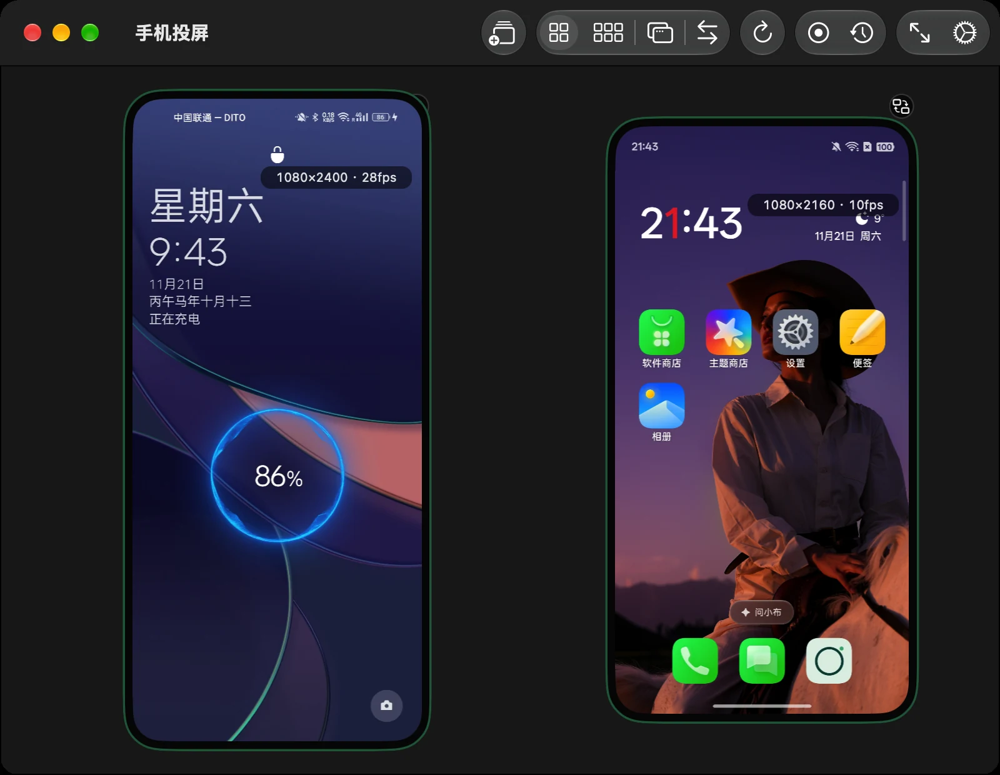
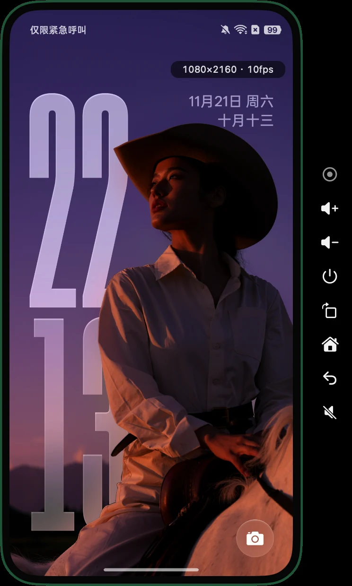
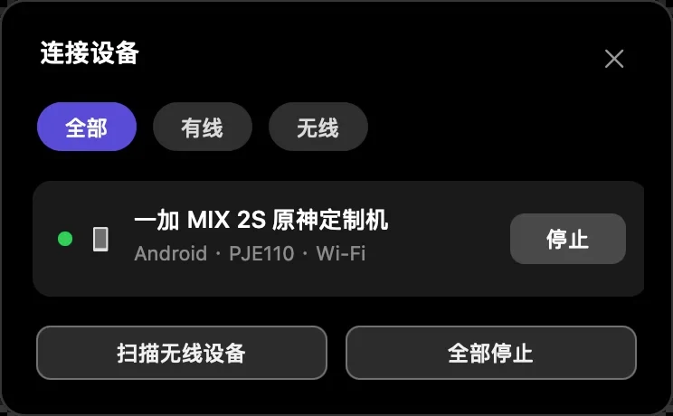
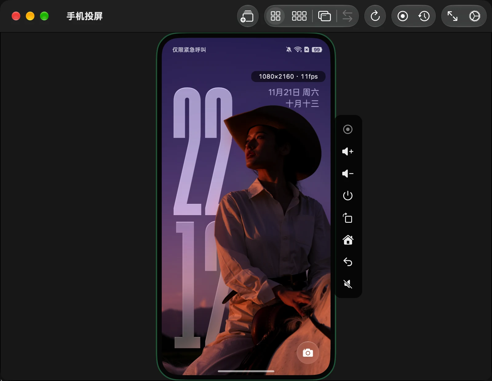
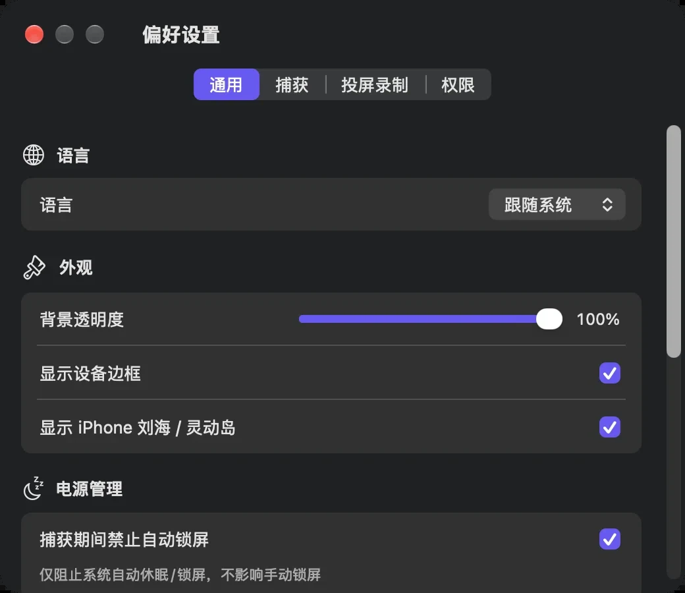

# StageCast

**English** · [简体中文](README.zh-CN.md)

[](LICENSE)
[](#requirements)
[](https://swift.org)
StageCast is a native macOS app that mirrors iOS and Android screens. It is built for product demos, QA reviews and screen recordings: several phones in one window, per-device floating windows, device-accurate bezels, and full mouse/keyboard control over Android.

No browser, no Electron, no server to install — one AppKit app that talks to devices directly.

> **Acknowledgement** — StageCast began as a derivative of [ScreenPresenter](https://github.com/HapticTide/ScreenPresenter) by Sun (MIT): the AppKit shell, the Metal pipeline and the capture paths started there. Bundled tools and libraries are credited in [CREDITS.md](CREDITS.md).

## Screenshots

| Auto layout · two devices | Floating windows |
|---|---|
|  |  |

| Device picker | Control bar on the mirror |
|---|---|
|  |  |

## Features

- **iOS mirroring** — the same capture path QuickTime uses (CoreMediaIO + AVFoundation).
- **Android mirroring** — bundled `scrcpy-server` stream decoded with VideoToolbox; works over USB **and** Wi-Fi.
- **Multiple devices, one window** — every connected phone gets its own tile; layouts are arranged automatically.
- **Three layout modes** — Auto, Grid, Floating, plus one-click Swap.
- **Floating windows** — one borderless window per device, sized to the device aspect ratio, with its own control bar, always-on-top option and position memory.
- **Android input control** — click, drag, scroll, type; right-click goes back, middle-click goes home, ⌥-drag pinch-zooms.
- **Device bezels** — 50+ device models with correct notch / Dynamic Island / punch-hole / side buttons.
- **Per-device recording** — record one tile or all tiles to MP4 + M4A, then replay inside the app.
- **Live stats** — resolution and frame rate in the corner of every mirror.
- **Metal rendering** — `CAMetalLayer` + `CVMetalTextureCache`, driven by `CVDisplayLink`.
- **Bilingual UI** — Simplified Chinese and English.

## Requirements

| | |
|---|---|
| macOS | 13.0 or later (Apple silicon and Intel) |
| iOS | USB connection, device unlocked and trusted |
| Android | USB debugging, or Android 11+ for wireless debugging |
| Android audio | Android 11+ (scrcpy audio channel) |
| Build from source | Xcode 16.4+, Swift 6.0+ |

## Installation

1. Download the latest `StageCast_x.y.z_universal.dmg` from [Releases](https://github.com/lwhsyy123/StageCast/releases).
2. Open the DMG and drag **StageCast** into `/Applications`.

### Opening an unsigned build

Release artifacts are not signed with an Apple Developer ID and are not notarized. If macOS blocks the first launch, remove the quarantine flag:

```bash
xattr -dr com.apple.quarantine /Applications/StageCast.app
open /Applications/StageCast.app
```

## Quick start

### Connect an Android device over USB

1. Enable **Developer options → USB debugging** on the phone.
2. Plug it in and accept the debugging prompt.
3. Click **Connect device** in the toolbar (or press `⌘K`) and press **Mirror** on the device row.

`adb` and `scrcpy-server` are bundled — nothing else to install.

### Connect an Android device over Wi-Fi

Three ways, in order of convenience:

| Method | Steps |
|---|---|
| **Wireless debugging** (Android 11+) | Phone: `Developer options → Wireless debugging` → **Pair device with pairing code**. In StageCast open **Connect device → Manual connection & pairing**, enter the IP, pairing port and 6-digit code, then **Pair and connect**. |
| **Enable over USB** | Plug in over USB → **Connect device → Manual connection & pairing → Enable wireless debugging** → unplug the cable → **Scan wireless devices**. |
| **Known port** | Enter `192.168.1.23:5555` (or whatever port the phone shows) in the IP field and press **Connect**. |

Wireless sessions can drop when the phone sleeps or changes network; press **Scan wireless devices** to rediscover it. Floating windows keep their place and offer **Reconnect**.

### Connect an iOS device

1. Connect over USB and tap **Trust this computer**.
2. Unlock the device.
3. StageCast asks for camera access the first time an iOS device is actually detected (the system mirroring path needs it).

> **iOS is mirror-only.** Apple exposes no supported channel for injecting touch or key events into a retail iPhone/iPad, so StageCast shows the screen but does not remote-control it. All Android devices support full control.

## Layout modes

Switch with the toolbar segment or **Capture → Layout**.

| Mode | Behaviour |
|---|---|
| **Auto** (`square.grid.2x2`) | Arranges itself: 1 device fills the window, 2 sit side by side, 3 in a 1×3 row, 4 in 2×2, more in a 3×2 / 3×3 grid. |
| **Grid** (`square.grid.3x2`) | Fixed grid, page size configurable in Preferences. |
| **Floating** (`macwindow.on.rectangle`) | Every device becomes its own window; the main window can auto-minimize. |
| **Swap** (`arrow.left.arrow.right`) | Exchanges the position of the first two devices. Enabled when 2+ devices are mirroring. |

### Floating window gestures

| Gesture | Result |
|---|---|
| Drag the top strip of the window | Move the window |
| Double-click the top strip | Re-center on the current screen |
| Drag any edge / corner | Resize — aspect ratio stays locked to the device |
| Right-click | Menu: Always on top · Zoom 50 / 75 / 100% · Move to center · Close |
| Hover, then click the close badge | Close the window — this also stops that device's capture |
| Device goes offline | The window stays, showing **Device disconnected → Reconnect** |

Window positions are remembered per device across launches.

## Button reference

### Toolbar (left to right)

| Button | Description |
|---|---|
| **Connect device** (`rectangle.stack.badge.plus`) | Opens the device picker. `⌘K` |
| **Layout** (4 segments) | Auto · Grid · Floating · Swap. |
| **Refresh** (`arrow.clockwise`) | Rescan USB and wireless devices. `⌘R` |
| **Record** (`record.circle`) | Start / stop recording every mirroring device. |
| **Recording history** | Browse, replay and delete previous recordings. |
| **Full screen** | Enter / leave full screen. `⌃⌘F` |
| **Preferences** (`gear`) | Preferences window. `⌘,` |

### Device picker

| Element | Description |
|---|---|
| **All / Wired / Wireless** | Filter the list by connection type. |
| Device row | Status dot, platform icon, name, model · connection · state, and a **Mirror / Stop** button. |
| **Manual connection & pairing** | Expands to IP field + **Connect**, **Enable wireless debugging**, pairing port / code + **Pair and connect**, and **Diagnostics**. |
| **Scan wireless devices** | Bonjour discovery + automatic `adb connect`. |
| **Stop all** | Stops every mirroring device. |

### Control bar (next to the mirror)

The bar appears when the pointer enters the mirror and hides ~4 s after it leaves. It is laid out horizontally under the mirror, and switches to a vertical strip beside the mirror when the window is too narrow (for example a portrait phone).

| Button | Description |
|---|---|
| **Record** | Record only this device. |
| **Volume +** / **Volume −** | Hardware volume keys. |
| **Power** | Power key (lock / wake). |
| **Rotate** | Rotate the device 90°. |
| **Home** | Go to the launcher. |
| **Back** | Back key. |
| **Mute** | Mute this device's audio without affecting the others. |

### Menus

| Menu item | Shortcut |
|---|---|
| Capture → Refresh devices | `⌘R` |
| Capture → Wireless connection… | `⌘⇧W` |
| Capture → Connect device | `⌘K` |
| Capture → Layout → Auto / Grid / Floating / Swap | — |
| Capture → Export logs… | `⌘⇧E` |
| Capture → Show device bezel | `⌘⇧B` |
| Capture → Prevent display sleep while mirroring | `⌘⇧S` |
| Capture → Mouse/keyboard control | `⌘⇧K` |
| Capture → Hide title bar | `⌘⇧H` |
| Capture → Color compensation… | `⌘⇧C` |

### Keyboard while controlling Android

| Input | Effect |
|---|---|
| Left click / drag | Tap / swipe |
| Right click | Back |
| Middle click | Home |
| Scroll wheel | Vertical scroll |
| ⌥ + drag | Pinch / rotate |
| Typing | Text input (non-ASCII goes through the clipboard) |
| `⌃V` | Paste the Mac clipboard into the phone |
| Esc · arrows · Return | Back · D-pad · Confirm |

## Preferences



| Tab | Contents |
|---|---|
| **General** | Language, background opacity, device bezel, camera overlay, prevent auto-lock, color compensation, layout (device order, grid page size, double-click to focus). |
| **Capture** | Frame rate, auto-minimize in floating mode, overlay stats, control bar, audio, scrcpy bitrate / size / port range / codec / input mode. |
| **Recording** | Save location, microphone capture. |
| **Permissions** | Camera / microphone, iOS and Android toolchain status. |

## Recording

Recording is per device: press the record button in a tile's control bar, or the toolbar button to record everything.

- Output: `~/Movies/StageCast Recordings/<date time>/<device>/`
- Files: `*.mp4` (HEVC), `*.m4a` (microphone), `session.json` (metadata)
- **Recording history** in the toolbar replays clips inside the app, with ±5 s skip.

## Build from source

```bash
git clone https://github.com/lwhsyy123/StageCast.git
cd StageCast

# secrets template is required by the build
cp StageCast/Core/Utilities/Secrets.swift.template StageCast/Core/Utilities/Secrets.swift

xcodebuild -project StageCast.xcodeproj \
  -scheme StageCast \
  -configuration Release \
  ONLY_ACTIVE_ARCH=NO ARCHS="arm64 x86_64" \
  CODE_SIGN_IDENTITY="-" CODE_SIGN_STYLE=Manual \
  CODE_SIGNING_REQUIRED=NO ENABLE_HARDENED_RUNTIME=NO \
  build

rm -f StageCast/Core/Utilities/Secrets.swift
```

Local ad-hoc signed builds must be built with `ENABLE_HARDENED_RUNTIME=NO`; otherwise the embedded Sparkle framework fails to load at launch.

## Project structure

```
StageCast/
├── AppDelegate.swift            # Menus, toolbar, app lifecycle
├── Core/
│   ├── AppState.swift           # Global state, per-device sources
│   ├── DeviceDiscovery/         # USB + Bonjour device providers
│   ├── DeviceSource/            # iOS (AVFoundation) and Android (scrcpy) sources
│   ├── Rendering/               # Metal renderer, VideoToolbox decoders
│   ├── Recording/               # Per-device recorder
│   └── Preferences/
├── Views/
│   ├── MainViewController.swift
│   ├── PreferencesWindowController.swift
│   └── Components/              # Panels, bezels, grid, picker, floating windows
├── Resources/Tools/             # Bundled adb + scrcpy-server
└── Resources/*.lproj/           # zh-Hans, en
```

## Troubleshooting

| Symptom | Fix |
|---|---|
| Android mirror stays black on the lock screen | Password / PIN screens set `FLAG_SECURE`; unlock the phone. |
| Wireless device disappeared | Phones drop adb over Wi-Fi after sleep. Press **Scan wireless devices** or re-enter `IP:port`. |
| "Device is in use" on iOS | Close QuickTime, Xcode devices window or any other app holding the device. |
| macOS refuses to open the app | `xattr -dr com.apple.quarantine /Applications/StageCast.app`. |
| No audio from Android | Audio needs Android 11+; check **Preferences → Capture → Audio**. |

## Contributing

Issues and pull requests are welcome. Please read [CONTRIBUTING.md](CONTRIBUTING.md) first.

## Credits

StageCast would not exist without these projects — the full list is in [CREDITS.md](CREDITS.md).

- [ScreenPresenter](https://github.com/HapticTide/ScreenPresenter) (MIT) — the original code base StageCast grew out of.
- [scrcpy](https://github.com/Genymobile/scrcpy) (Apache-2.0) — Android mirroring; `scrcpy-server` is bundled unmodified.
- Android `adb` from [platform-tools](https://developer.android.com/tools/releases/platform-tools) (Apache-2.0) — bundled for device discovery and port forwarding.
- [Sparkle](https://github.com/sparkle-project/Sparkle) (MIT) — app updates.
- [swift-opus](https://github.com/alta/swift-opus) / [libopus](https://github.com/xiph/opus) (BSD-3-Clause) — Opus audio.
- [FBDeviceControlKit](https://github.com/facebook/idb) (MIT) — iOS device discovery.

## License

[MIT](LICENSE) © 2026 Sun and StageCast contributors. Third-party components keep their own licenses — see [CREDITS.md](CREDITS.md).
