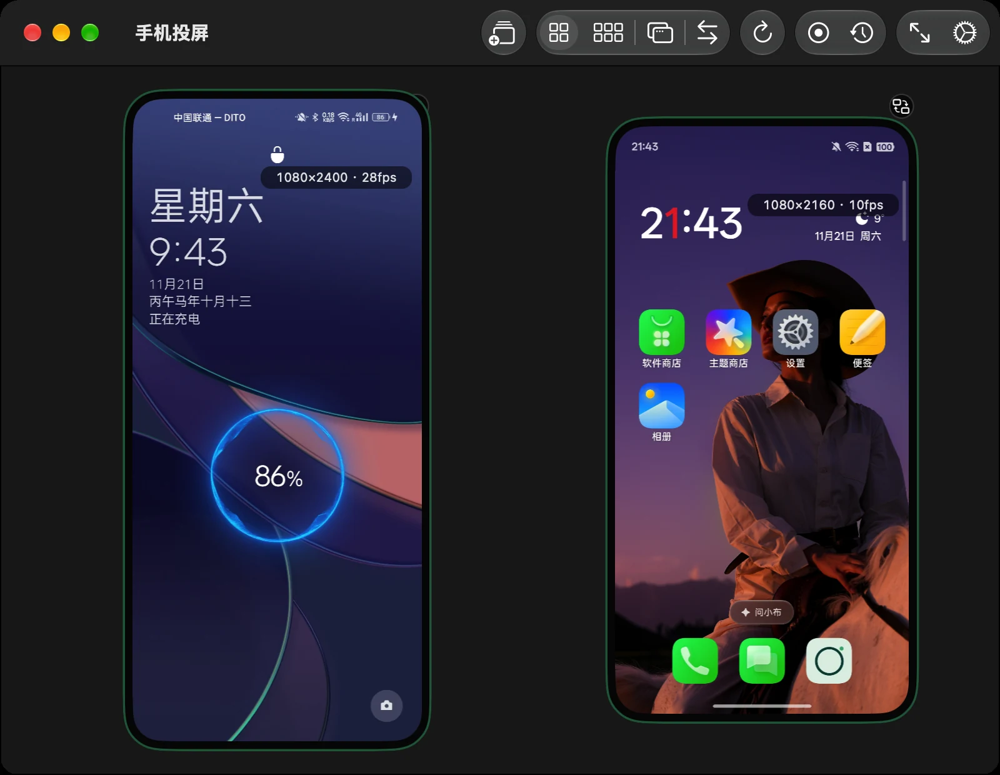
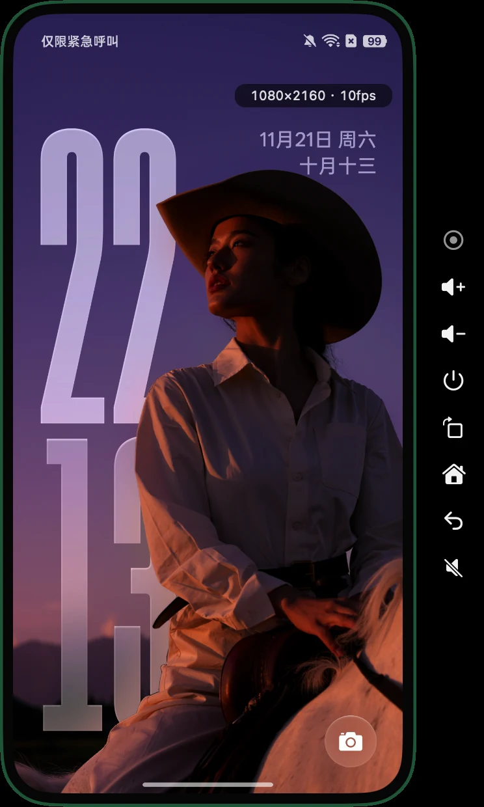
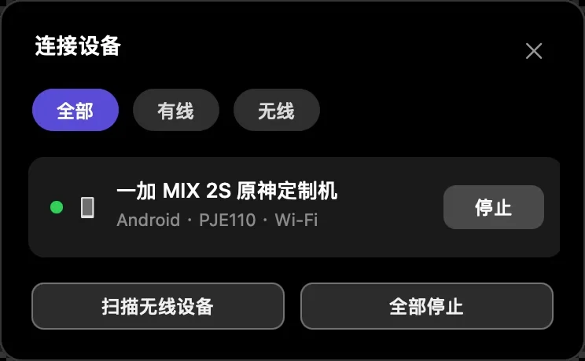
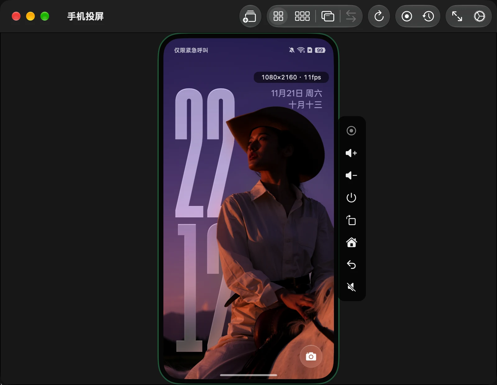
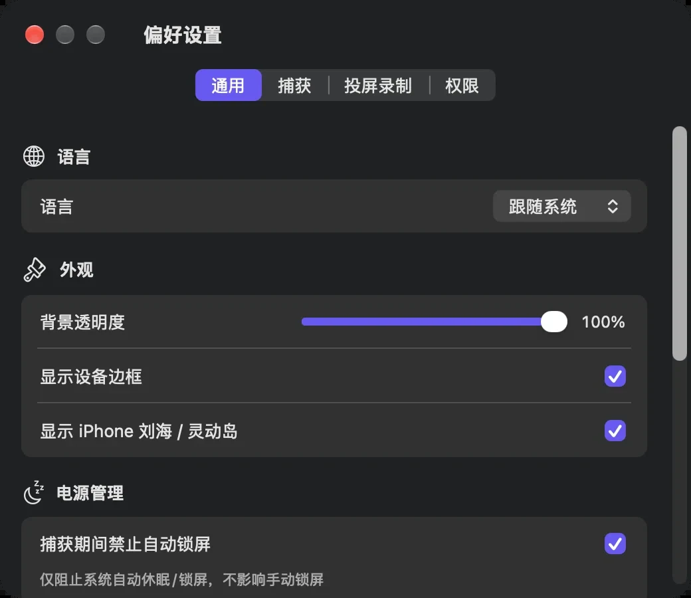

# StageCast · 手机投屏

[English](README.md) · **简体中文**

[](LICENSE)
[](#系统要求)
[](https://swift.org)
StageCast 是一款 macOS 原生投屏工具，把 iPhone 和 Android 手机的画面直接搬进 Mac 窗口。它是为产品演示、验收评审和录屏准备的：一个窗口里并排展示多台手机、每台设备还能独立浮动成一个小窗，配上按真机绘制的机身边框，并且可以完整地用鼠标键盘操作 Android。

没有浏览器壳，没有 Electron，也不用另装服务端——一个 AppKit 应用直接和设备通信。

> **说明** —— StageCast 由 Sun 的 [ScreenPresenter](https://github.com/HapticTide/ScreenPresenter)（MIT）衍生而来：AppKit 界面骨架、Metal 渲染管线与采集链路最初都来自该项目。随包分发的工具与依赖库见 [CREDITS.md](CREDITS.md)。

## 界面截图

| 自动排列 · 双设备 | 独立浮窗 |
|---|---|
|  |  |

| 连接设备面板 | 画面旁的控制条 |
|---|---|
|  |  |

## 功能特性

- **iOS 投屏**：和 QuickTime 同一条采集链路（CoreMediaIO + AVFoundation）。
- **Android 投屏**：内置 `scrcpy-server` 码流，VideoToolbox 硬解；支持 **USB** 与 **Wi-Fi**。
- **多设备同窗**：每台在投屏的手机各占一格，布局自动排布。
- **三种布局模式**：自动排列、网格布局、独立浮窗，外加一键交换位置。
- **独立浮窗**：每台设备一个无边框窗口，按整机比例自适应尺寸，各自带控制条，可置顶、可记忆位置。
- **Android 反向控制**：点击、拖拽、滚轮、键盘输入；右键返回、中键回桌面、⌥ 拖拽双指缩放。
- **仿真机身边框**：50+ 机型，刘海 / 灵动岛 / 打孔屏 / 侧键按真机绘制。
- **按格录制**：单格或全部设备录成 MP4 + M4A，App 内直接回看。
- **实时角标**：每格右上角显示分辨率与帧率。
- **Metal 渲染**：`CAMetalLayer` + `CVMetalTextureCache`，`CVDisplayLink` 驱动。
- **中英双语**：界面语言可切换。

## 系统要求

| | |
|---|---|
| macOS | 13.0 或更高（Apple 芯片与 Intel） |
| iOS | USB 连接，设备已解锁并信任本机 |
| Android | 已开启 USB 调试，或 Android 11+ 的无线调试 |
| Android 音频 | Android 11+（scrcpy 音频通道） |
| 源码构建 | Xcode 16.4+、Swift 6.0+ |

## 安装

1. 从 [Releases](https://github.com/lwhsyy123/StageCast/releases) 下载最新的 `StageCast_x.y.z_universal.dmg`。
2. 打开 DMG，把 **StageCast** 拖进 `/Applications`。

### 打开未签名构建

发布产物未使用 Apple Developer ID 签名，也未公证。如果首次启动被系统拦下，去掉隔离属性即可：

```bash
xattr -dr com.apple.quarantine /Applications/StageCast.app
open /Applications/StageCast.app
```

## 快速开始

### Android：USB 连接

1. 手机打开「开发者选项 → USB 调试」。
2. 插上数据线，在手机上允许调试授权。
3. 点工具栏 **连接设备**（或 `⌘K`），在设备行上点 **投屏**。

`adb` 与 `scrcpy-server` 已内置，不需要另外安装工具链。

### Android：无线连接

三条路，按方便程度排序：

| 方式 | 步骤 |
|---|---|
| **无线调试**（Android 11+） | 手机「开发者选项 → 无线调试 → 使用配对码配对设备」。StageCast 打开 **连接设备 → 手动连接与配对**，填入 IP、配对端口和 6 位配对码，点 **配对并连接**。 |
| **USB 开启无线** | USB 插上 → **连接设备 → 手动连接与配对 → 开启无线调试** → 拔掉数据线 → **扫描无线设备**。 |
| **已知端口** | 直接在 IP 输入框填 `192.168.1.23:5555`（或手机显示的端口），点 **连接**。 |

手机休眠或换网络后无线会话可能掉线，点 **扫描无线设备** 重新发现即可；独立浮窗会保留位置并给出 **重新连接** 按钮。

### iOS：USB 连接

1. USB 连接后在手机上点「信任此电脑」。
2. 解锁设备。
3. 真正检测到 iOS 设备时，App 才会申请相机权限（系统投屏链路需要）。

> **iOS 只能投屏，不能反向控制。** Apple 没有为零售版 iPhone/iPad 开放注入触摸/按键的受支持通道，所以 StageCast 只显示画面。Android 设备支持完整控制。

## 布局模式

用工具栏的布局段切换，或走菜单 **捕获 → 布局**。

| 模式 | 行为 |
|---|---|
| **自动排列**（`square.grid.2x2`） | 自己算：1 台满窗口，2 台左右并排，3 台 1×3，4 台 2×2，更多则 3×2 / 3×3。 |
| **网格布局**（`square.grid.3x2`） | 固定网格，每页设备数可在偏好设置里改。 |
| **独立浮窗**（`macwindow.on.rectangle`） | 每台设备变成独立窗口，主窗口可自动最小化。 |
| **交换**（`arrow.left.arrow.right`） | 交换前两台设备的位置；两台及以上在投屏时可用。 |

### 浮窗手势

| 操作 | 效果 |
|---|---|
| 拖拽窗口顶部条 | 移动窗口 |
| 双击顶部条 | 回到当前屏幕中央 |
| 拖拽任意边 / 角 | 缩放；宽高比锁定为设备比例，不会出现黑边 |
| 右键 | 菜单：窗口置顶 · 缩放 50% / 75% / 100% · 移到屏幕中央 · 关闭 |
| 悬停后点关闭徽标 | 关窗，同时停止该设备投屏 |
| 设备掉线 | 窗口保留，显示 **设备已断开 → 重新连接** |

窗口位置按设备记忆，下次启动回到原处。

## 按钮说明

### 工具栏（从左到右）

| 按钮 | 说明 |
|---|---|
| **连接设备**（`rectangle.stack.badge.plus`） | 打开设备选择面板。`⌘K` |
| **布局**（四段） | 自动排列 · 网格布局 · 独立浮窗 · 交换位置。 |
| **刷新**（`arrow.clockwise`） | 重新扫描 USB 与无线设备。`⌘R` |
| **录制**（`record.circle`） | 开始 / 停止录制所有在投屏的设备。 |
| **录制历史** | 浏览、回看、删除历史录制。 |
| **全屏** | 进入 / 退出全屏。`⌃⌘F` |
| **偏好设置**（`gear`） | 打开偏好设置。`⌘,` |

### 连接设备面板

| 元素 | 说明 |
|---|---|
| **全部 / 有线 / 无线** | 按连接方式过滤设备列表。 |
| 设备行 | 状态点、平台图标、设备名、型号 · 连接方式 · 状态，以及 **投屏 / 停止** 按钮。 |
| **手动连接与配对** | 展开后是 IP 输入 + **连接**、**开启无线调试**、配对端口 / 配对码 + **配对并连接**，以及 **诊断**。 |
| **扫描无线设备** | Bonjour 发现 + 自动 `adb connect`。 |
| **全部停止** | 停止所有正在投屏的设备。 |

### 控制条（画面旁）

鼠标移进画面时出现，移开后约 4 秒自动收起。默认横排贴在画面下边缘居中；窗口太窄时（比如竖屏手机）自动改成竖排，贴在画面右侧。

| 按钮 | 说明 |
|---|---|
| **录制** | 只录这一台设备。 |
| **音量 +** / **音量 −** | 对应手机音量键。 |
| **电源** | 电源键（锁屏 / 唤醒）。 |
| **旋转** | 旋转屏幕 90°。 |
| **主屏幕** | 回到桌面。 |
| **返回** | 返回键。 |
| **静音** | 只静音这一台，不影响其他设备。 |

### 菜单

| 菜单项 | 快捷键 |
|---|---|
| 捕获 → 刷新设备 | `⌘R` |
| 捕获 → 无线连接… | `⌘⇧W` |
| 捕获 → 连接设备 | `⌘K` |
| 捕获 → 布局 → 自动排列 / 网格布局 / 独立浮窗 / 交换 | — |
| 捕获 → 导出日志… | `⌘⇧E` |
| 捕获 → 显示设备边框 | `⌘⇧B` |
| 捕获 → 捕获时禁止息屏 | `⌘⇧S` |
| 捕获 → 鼠标/键盘控制手机 | `⌘⇧K` |
| 捕获 → 隐藏标题栏 | `⌘⇧H` |
| 捕获 → 颜色补偿… | `⌘⇧C` |

### 控制 Android 时的按键

| 输入 | 效果 |
|---|---|
| 左键点击 / 拖拽 | 点按 / 滑动 |
| 右键 | 返回 |
| 中键 | 回到桌面 |
| 滚轮 | 上下滚动 |
| ⌥ + 拖拽 | 双指缩放 / 旋转 |
| 键盘输入 | 文字输入（非 ASCII 字符经剪贴板粘贴） |
| `⌃V` | 把 Mac 剪贴板粘贴到手机 |
| Esc · 方向键 · 回车 | 返回 · 方向 · 确认 |

## 偏好设置



| 标签页 | 内容 |
|---|---|
| **通用** | 语言、背景不透明度、设备边框、摄像头装饰、禁止自动锁屏、颜色补偿、布局（设备左右位置、网格每页设备数、双击聚焦）。 |
| **捕获** | 捕获帧率、浮窗模式下自动最小化、画面角标、控制条显隐、音频捕获 / 音量 / 编码、scrcpy 比特率、最大尺寸、端口范围、编码器、输入模式、显示触摸点。 |
| **投屏录制** | 保存位置、麦克风录制。 |
| **权限** | 相机 / 麦克风状态，iOS 与 Android 工具链状态。 |

## 录制

录制以设备为单位：点某一格控制条上的录制按钮只录这一台；点工具栏录制按钮则录制全部。

- 保存位置：`~/Movies/StageCast Recordings/<日期 时间>/<设备>/`
- 产物：`*.mp4`（HEVC）、`*.m4a`（麦克风）、`session.json`（元信息）
- 工具栏 **录制历史** 可在 App 内回看，支持前后 5 秒跳转。

## 从源码构建

```bash
git clone https://github.com/lwhsyy123/StageCast.git
cd StageCast

# 构建需要密钥模板
cp StageCast/Core/Utilities/Secrets.swift.template StageCast/Core/Utilities/Secrets.swift

xcodebuild -project StageCast.xcodeproj \
  -scheme StageCast \
  -configuration Release \
  ONLY_ACTIVE_ARCH=NO ARCHS="arm64 x86_64" \
  CODE_SIGN_IDENTITY="-" CODE_SIGN_STYLE=Manual \
  CODE_SIGNING_REQUIRED=NO ENABLE_HARDENED_RUNTIME=NO \
  build

rm -f StageCast/Core/Utilities/Secrets.swift
```

本机 ad-hoc 签名的构建必须带 `ENABLE_HARDENED_RUNTIME=NO`，否则启动时会因为内置 Sparkle framework 加载失败而崩溃。

## 项目结构

```
StageCast/
├── AppDelegate.swift            # 菜单、工具栏、应用生命周期
├── Core/
│   ├── AppState.swift           # 全局状态、按设备管理的源
│   ├── DeviceDiscovery/         # USB + Bonjour 设备发现
│   ├── DeviceSource/            # iOS（AVFoundation）与 Android（scrcpy）实现
│   ├── Rendering/               # Metal 渲染、VideoToolbox 解码
│   ├── Recording/               # 按设备录制
│   └── Preferences/
├── Views/
│   ├── MainViewController.swift
│   ├── PreferencesWindowController.swift
│   └── Components/              # 面板、边框、网格、选择器、浮窗
├── Resources/Tools/             # 内置 adb + scrcpy-server
└── Resources/*.lproj/           # zh-Hans、en
```

## 常见问题

| 现象 | 处理 |
|---|---|
| Android 锁屏时投屏全黑 | 密码 / PIN 界面带 `FLAG_SECURE`，解锁手机即可。 |
| 无线设备不见了 | 手机休眠后 adb over Wi-Fi 会断开。点 **扫描无线设备**，或用 `IP:端口` 重新连接。 |
| iOS 提示设备被占用 | 关掉 QuickTime、Xcode 的 Devices 窗口等正在占用设备的应用。 |
| macOS 不让我打开 App | `xattr -dr com.apple.quarantine /Applications/StageCast.app`。 |
| Android 没有声音 | 音频通道需要 Android 11+，检查 **偏好设置 → 捕获 → 音频**。 |

## 参与贡献

欢迎提 Issue 和 PR，动手前请先读 [CONTRIBUTING.md](CONTRIBUTING.md)。

## 致谢

没有这些项目就没有 StageCast，完整清单见 [CREDITS.md](CREDITS.md)。

- [ScreenPresenter](https://github.com/HapticTide/ScreenPresenter)（MIT）—— StageCast 的初始代码库。
- [scrcpy](https://github.com/Genymobile/scrcpy)（Apache-2.0）—— Android 投屏，内置的 `scrcpy-server` 未做修改。
- Android `adb`（[platform-tools](https://developer.android.com/tools/releases/platform-tools)，Apache-2.0）—— 用于设备发现与端口转发。
- [Sparkle](https://github.com/sparkle-project/Sparkle)（MIT）—— 应用更新。
- [swift-opus](https://github.com/alta/swift-opus) / [libopus](https://github.com/xiph/opus)（BSD-3-Clause）—— Opus 音频。
- [FBDeviceControlKit](https://github.com/facebook/idb)（MIT）—— iOS 设备发现。

## 许可证

[MIT](LICENSE) © 2026 Sun 与 StageCast contributors。第三方组件保留各自许可证，见 [CREDITS.md](CREDITS.md)。
